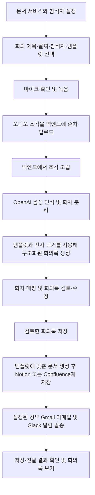

# Meeting Automation

회의를 녹음하고, 음성을 화자별로 정리한 뒤 선택한 템플릿에 맞는 회의록을 만드는 웹 서비스입니다. 사용자가 내용을 검토하고 수정하면 Notion 또는 Confluence에 저장하고, 설정된 경우 참석자에게 이메일과 Slack 알림을 보냅니다.

## 서비스가 하는 일

- 회의 제목, 날짜, 참석자, 회의록 템플릿을 선택해 회의를 시작합니다.
- 브라우저에서 마이크 입력을 확인하고 회의를 녹음합니다. 오디오 조각은 회의 중 백엔드로 전송됩니다.
- OpenAI 음성 인식으로 한국어 발화와 화자 구간을 만듭니다.
- 참석자를 화자에 연결하고, 템플릿 기반으로 생성된 회의록을 검토·수정합니다.
- 확인한 회의록을 Notion 또는 Confluence에 저장하고 설정된 알림을 발송합니다.
- 회의 목록, 회의 상세, 전사 내용과 저장·전달 결과를 확인합니다.

## 회의 처리 흐름



### 음성 인식과 회의록 작성

음성 처리와 회의록 생성은 백엔드가 OpenAI API를 호출합니다. 브라우저에는 OpenAI API 키를 넣지 않습니다.

1. 프런트엔드는 `MediaRecorder`로 오디오를 일정한 조각으로 만들고, 각 조각을 백엔드 오디오 API로 업로드합니다.
2. 백엔드는 조각을 합친 뒤 OpenAI Audio Transcriptions API에 전달합니다. 기본 전사 모델은 `gpt-4o-transcribe-diarize`이며, `diarized_json` 형식으로 발화 내용과 화자 구간을 받습니다. 백엔드는 결과를 서비스 내부의 화자 ID, 발화 구간, 타임스탬프 구조로 정규화합니다.
3. 회의록 초안 생성 시 선택한 템플릿의 내용과 작성 지침, 회의 정보, 참석자, 화자 매핑, 전사 내용을 OpenAI Chat Completions API에 전달합니다. 기본 모델은 `gpt-6-luna`입니다. JSON Schema 기반 응답을 사용하고, 생성된 문장마다 근거가 되는 전사 구간 ID를 요구·검증해 회의록을 구조화합니다.
4. 사용자는 화자와 참석자를 매핑하고 회의록을 검토·수정합니다.
5. 문서 저장 시에는 **선택한 템플릿과 검토 완료된 회의록**을 문서 작성 모델에 전달합니다. 템플릿의 제목과 섹션 순서를 따르는 Markdown 본문을 생성한 뒤 연결된 문서 서비스에 저장합니다. 전사 원문을 그대로 회의록으로 복사하는 단계가 아닙니다.

모델은 백엔드 설정의 `TRANSCRIPTION_MODEL`, `MINUTES_MODEL`로 바꿀 수 있습니다. 모델 ID와 API 동작은 OpenAI API와 계정 설정을 따릅니다.

## 주요 기능

| 영역 | 기능 |
|---|---|
| 회의 | 새 회의 생성, 날짜·참석자·템플릿 지정, 목록 검색과 상세 조회 |
| 녹음 | 브라우저 마이크 확인, 입력 레벨 표시, 녹음·일시 정지·재개, 오디오 조각 업로드 재시도 |
| 음성 처리 | 한국어 전사, 화자 분리, 처리 단계별 상태와 오류 표시, 재시도 |
| 회의록 검토 | 화자-참석자 연결, 요약·논의·결정·실행 항목 편집, 저장 후 검토 완료 |
| 문서 연결 | Notion 또는 Confluence Cloud 연결, 기본 문서 구조 및 기본 회의록 템플릿 생성 |
| 문서 저장 | 선택한 템플릿에 맞춰 검토된 내용을 문서로 작성하고 회의록 ID로 중복 생성 방지 |
| 이메일 | Gmail API OAuth 2.0 설정, 저장 후 참석자에게 회의록 본문 전달 |
| Slack | Incoming Webhook 설정과 연결 확인, 저장된 회의록 알림 전송 |

문서 연결 시 `Meeting Automation` 아래에 `Meetings`, `Participants`, `Meeting Data`, `Templates` 구조를 준비하고 기본 템플릿을 등록합니다. 기본 템플릿은 [`backend/src/main/resources/templates/default.md`](backend/src/main/resources/templates/default.md)에 있습니다.

## 기술 구성

| 구분 | 기술 |
|---|---|
| 프런트엔드 | React 19, TypeScript 5, Vite 7, React Router 8 |
| 브라우저 미디어 | `getUserMedia`, `MediaRecorder`, Web Audio API (`AudioContext` / `AnalyserNode`) |
| 백엔드 | Java 25, Spring Boot 4.1, Spring MVC, Bean Validation, Actuator |
| 빌드 | 프런트엔드 npm, 백엔드 Gradle Wrapper |
| 음성·생성 AI | OpenAI Audio Transcriptions API, OpenAI Chat Completions API, JSON Schema 응답 |
| 문서 서비스 | Notion API, Confluence Cloud REST API v2 |
| 알림 | Gmail API, Slack Incoming Webhook |
| 배포 구성 | Vercel용 정적 프런트엔드, 현재 Render 백엔드, Artifact Registry와 GCE VM 배포 workflow |

GCE 백엔드 배포의 VM 준비, Actions secrets, 네트워크와 용량 조건은 [배포 안내](docs/setup/gcloud-backend-deployment.md)를 참고하세요.

## 저장 구조와 운영상 참고

- 저장이 끝난 회의록과 참석자 정보는 연결된 Notion 또는 Confluence에 기록됩니다. 이 프로젝트는 SQL 데이터베이스를 사용하지 않습니다.
- 진행 중인 회의 세션, 처리 작업 상태와 작업 큐는 백엔드 프로세스 메모리에 있습니다. 백엔드가 재시작되면 진행 중인 작업 상태가 사라질 수 있습니다.
- 오디오 조각과 조립된 오디오는 `TEMP_AUDIO_DIR` 아래의 임시 파일로 처리합니다. 회의록 생성에 성공하면 오디오를 지우고, 실패한 처리의 재시도용 오디오는 만료 정리 대상입니다. 이 디렉터리는 영구 저장소나 백업이 아닙니다.
- 문서 연결 정보는 브라우저 `localStorage`에도 저장되므로 브라우저 프로필과 기기별로 유지됩니다. 다른 브라우저나 기기에는 자동 동기화되지 않으며 해당 환경에서 다시 연결해야 합니다.
- 로컬 백엔드의 설정 파일 저장을 사용할 때는 `DOCUMENT_SETTINGS_DIR`과 `DOCUMENT_SETTINGS_ENCRYPTION_KEY`를 설정합니다. 파일은 저장소 바깥에 두고 키와 토큰은 Git에 커밋하지 않습니다.

## 개발 환경

- Node.js 24.x와 npm
- JDK 25
- Git
- 문서 연결 및 실제 AI 처리를 확인하려면 Notion 또는 Confluence 연결 정보와 OpenAI API 키

### 프런트엔드 실행

```bash
cd frontend
npm ci
npm run dev
```

개발 서버 주소는 보통 `http://localhost:5173`입니다. Vite 개발 설정은 `/api` 요청을 `http://127.0.0.1:8080`으로 전달하므로 백엔드도 실행해야 합니다.

### 백엔드 실행

별도 터미널에서 저장소 루트 기준:

```bash
cd backend
./gradlew bootRun
```

Windows PowerShell에서는 다음을 사용합니다.

```powershell
cd backend
.\gradlew.bat bootRun
```

로컬 백엔드 기본 주소는 `http://localhost:8080`입니다. 상태 확인 주소는 `http://localhost:8080/api/v1/system/health`입니다.

### 백엔드 설정

Spring Boot는 `.env` 파일을 자동으로 읽지 않습니다. 환경 변수 또는 Git에서 제외되는 `backend/application-local.yml`을 사용하세요. `application.yml`은 이 로컬 설정 파일을 선택적으로 불러옵니다.

예시:

```yaml
openai:
  api-key: ${OPENAI_API_KEY:}
transcription:
  model: ${TRANSCRIPTION_MODEL:gpt-4o-transcribe-diarize}
  timeout-seconds: ${TRANSCRIPTION_TIMEOUT_SECONDS:1800}
minutes:
  model: ${MINUTES_MODEL:gpt-6-luna}
  timeout-seconds: ${MINUTES_TIMEOUT_SECONDS:600}
```

필요에 따라 다음 설정을 환경 변수로 제공합니다.

| 변수 | 용도 |
|---|---|
| `OPENAI_API_KEY` | 음성 인식 및 회의록 생성 API 인증 |
| `TRANSCRIPTION_MODEL`, `MINUTES_MODEL` | 사용할 OpenAI 모델 지정 |
| `DOCUMENT_SETTINGS_DIR` | 로컬 암호화 문서 설정 파일을 보관할 저장소 밖의 절대 경로 |
| `DOCUMENT_SETTINGS_ENCRYPTION_KEY` | 문서 설정 파일 암호화 키 (Base64 인코딩된 32바이트 키) |
| `TEMP_AUDIO_DIR` | 오디오 임시 파일 경로 |
| `ALLOWED_ORIGINS` | 백엔드가 허용할 프런트엔드 Origin 목록 |
| `EMAIL_OAUTH_CLIENT_ID`, `EMAIL_OAUTH_CLIENT_SECRET`, `EMAIL_OAUTH_REFRESH_TOKEN`, `EMAIL_SENDER_ADDRESS` | Gmail API 발송 설정 |
| `SLACK_MEETING_WEBHOOK_URL` | 회의 완료 알림용 Slack Incoming Webhook |

문서 서비스 토큰과 Slack Webhook 등 Secret을 README, 프런트엔드 환경 변수, 소스 코드에 넣지 마세요. 예시 파일은 변수 이름을 확인하는 용도이며 실제 값을 포함하지 않습니다.

### 유용한 명령

프런트엔드 (`frontend/`):

```bash
npm run build
npm run lint
npm test
```

백엔드 (`backend/`):

```bash
./gradlew test
./gradlew bootJar
```

## 저장소 구조

```text
frontend/                         React 웹 앱과 브라우저 녹음·업로드 처리
backend/                          Spring Boot REST API와 외부 서비스 Adapter
  src/main/java/.../transcription OpenAI 전사 Adapter와 화자 결과 정규화
  src/main/java/.../minutes       구조화 회의록 생성과 문서 본문 작성
  src/main/java/.../document      Notion·Confluence 연동과 기본 구조 생성
  src/main/java/.../email         Gmail API 발송
  src/main/java/.../notification  Slack 알림
  src/main/resources/templates    기본 회의록 템플릿
docs/product/                     제품 요구사항, API, 아키텍처, 연동 설계
```

## 더 읽을 문서

- [현재 구현 기준](docs/product/implementation-status.md)
- [제품 요구사항](docs/product/PRD.md)
- [시스템 아키텍처](docs/product/architecture.md)
- [API 명세](docs/product/api-spec.md)
- [외부 서비스 연동 설계](docs/product/integrations.md)
- [프런트엔드 개발 환경 안내](docs/setup/frontend-setup.md)
- [백엔드 개발 환경 안내](docs/setup/backend-setup.md)
