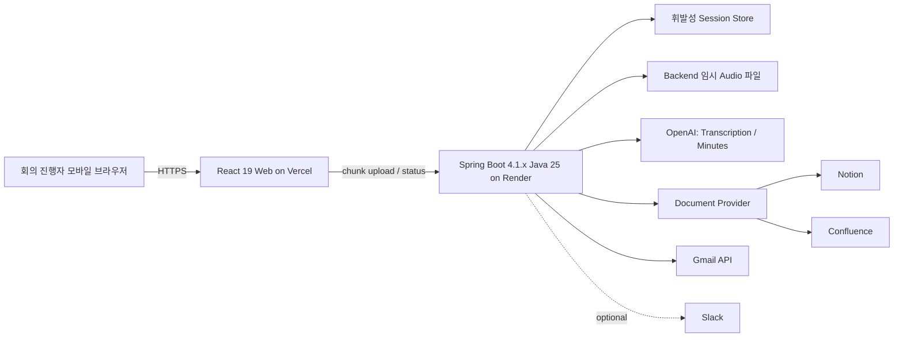

# Meeting Automation Architecture

> **문서 역할:** PRD의 시스템 구조, 경계, 런타임 흐름을 구현 가능한 수준으로 정의한다.
> **기준 문서:** [PRD.md](./PRD.md)
> **적용 범위:** Meeting Automation V1
> **기준일:** 2026-10-16 · PRD v2.1.0 draft
> **제품 흐름 상세:** [최초 연결·자동 발송 기준 흐름](../superpowers/specs/2026-10-16-first-run-and-autodelivery-design.md)

## 문서 경계

- 제품 목표, 사용자 시나리오, 범위, 확정 의사결정은 [PRD.md](./PRD.md)가 기준이다.
- 엔티티와 직렬화 형태는 [data-spec.md](./data-spec.md)가 기준이다.
- HTTP 계약은 [api-spec.md](./api-spec.md)가 기준이다.
- 외부 Provider 포트와 Adapter 동작은 [integrations.md](./integrations.md)가 기준이다.
- 이 문서는 서비스와 런타임의 경계 및 흐름을 정의하며 위 문서의 세부 계약을 중복 정의하지 않는다.

## 시스템 경계



V1은 단일 회사용 모바일 웹이다. 연결 정보가 없을 때도 Frontend와 설정 API는 열리며 문서 연결 화면을 제공한다. 회의 업무는 문서 연결과 기본 Page 초기화가 READY가 된 뒤에만 허용한다. 첫 Bootstrap 완료 뒤에는 New Meeting으로, 이후 방문은 Home으로 이동한다. 브라우저는 녹음 권한 획득, MediaRecorder 운용, chunk 임시 보관/Backend 전송, Speaker 매핑 UI를 담당한다. Backend는 설정 상태, 세션, Audio 수신·조립, 전사·화자 분리, 매핑 이후 Minutes 생성, 문서 저장과 Gmail 자동 발송을 담당한다. 저장된 Provider Secret은 Backend만 보유한다. 제품 계정·로그인·사용자별 설정은 없다.

## 런타임 및 배포 단위

| 단위 | 기준 | 책임 |
|---|---|---|
| Frontend | Node.js 24 LTS, React 19, TypeScript 5.x, Vite 7.x, npm | 모바일 UI, 녹음 제어, 재전송 가능한 chunk queue, REST 호출 |
| Backend | Java 25, Spring Boot 4.1.x, Gradle 9.x (9.1+) | REST API, workflow orchestration, Provider Adapter |
| Frontend 배포 | Vercel | 정적 웹 자산 제공 |
| Backend 배포 | Render | Spring Boot 프로세스와 작업 실행 |
| 임시 Audio 저장 | Backend 임시 파일시스템 | 업로드 chunk와 조립 파일을 처리 중 보관하고 이후 정리 |
| 전역 연결 설정 | Backend 설정 저장소 | 암호화한 연결 설정 및 초기화/이전 journal |
| 외부 영속 저장 | Notion 또는 Confluence | Participant와 완료된 회의 문서의 Source of Truth |

Frontend와 Backend는 독립 build/deploy한다. Node.js는 Frontend toolchain으로 사용하며 오디오 조각 수신·검증·조립과 업무 API는 Spring Boot가 담당한다. Vercel은 Frontend를 제공하고 오디오 저장소 API는 제공하지 않는다. 임시 파일의 영속성 및 재시작 복구는 호스팅 결정에 따른다. 데이터베이스, JPA, Redis, queue, message broker, batch는 현재 기준으로 도입하지 않는다. 배포 환경 변수와 확인 순서는 [운영 테스트 설정 기준](../setup/production-test.md)에 둔다.

## Backend 구성과 의존성 방향

권장 패키지 경계:

```text
domain/
  meeting/ participant/ transcript/ minutes/ delivery/
application/
  usecase/ port/in/ port/out/
adapter/in/web/
adapter/out/ai/ document/ email/ notification/ storage/
configuration/
```

- `domain`: 상태 전이, 값 객체, 도메인 규칙. 외부 SDK와 Spring Web 타입을 참조하지 않는다.
- `application`: 유스케이스 실행과 트랜잭션 경계. Port에만 의존한다.
- `adapter/in/web`: API DTO, validation, HTTP status/header 변환.
- `adapter/out/*`: 외부 API 및 임시 저장소 구현. Provider 타입은 Adapter 내부 DTO에서 표준 DTO로 변환한다.
- `configuration`: 배포 기반 설정, 전역 문서 설정 저장 Port, 저장된 활성 연결 Resolver, CORS, HTTP client, 실행기 구성.

의존성은 `adapter → application → domain` 방향으로만 흐른다. Provider 구현 교체가 Domain/API DTO 변경을 요구하지 않도록 한다. 외부 HTTP client는 프로젝트에서 선택한 한 가지 기본 방식(Spring RestClient 또는 Apache HttpClient5)을 공통 사용한다.

## 핵심 컴포넌트 책임

| 컴포넌트 | 책임 | 소유하지 않는 책임 |
|---|---|---|
| Meeting API | 입력 검증, 상태/버전 검사, 유스케이스 호출 | Provider별 payload 구성 |
| Meeting Workflow | 상태 전이와 처리 순서 조정 | 장기 영속화 보장 |
| Session Store | 진행 중 Session 및 최대 100건 미만 목록 캐시 보관 | 서비스 재시작 후 복구 |
| Audio Service | sequence 검증, 비공개 객체 저장·조립, MIME/크기 검증, 처리 후 삭제 | 원본 Audio 장기 보관 |
| Private Audio Storage Port | 비공개 객체 읽기/쓰기/삭제, 만료 metadata와 만료 sweep | 공개 URL 제공, 장기 보관 |
| Template Service | `default.md`, `project.md` 로딩과 버전 관리 | Provider 문서 템플릿 저장 |
| Transcription Port | Audio → 표준 Transcript/Speaker 결과 | 실제 Participant 식별 |
| Minutes Port | Transcript, mapping, template 입력 → 구조화 Minutes | 근거 없는 사실/담당자 추론 허용 |
| Document Port | Participant와 Meeting 읽기/쓰기 | 앱 전용 DB 역할 |
| Bootstrap Service | Home·Meetings·Participants·Templates·Speaker Memory 기본 Page 생성/검증 | 일반 조회 중 묵시적 페이지 생성 |
| Speaker Memory | 사용자 확인 매핑 저장 및 이후 매핑 UI의 후보 제공 | voiceprint/자동 실명 화자 인식 |
| Delivery Ports | Email 및 Notification 개별 전송 결과 | 채널 간 결과를 하나로 합치기 |

## 주요 흐름

### 최초 진입 및 기본 구조 준비

1. Frontend가 App Config를 읽고 `UNCONFIGURED`/미초기화면 문서 연결 위저드로 보낸다. Storage error와 기존 Provider 일시 장애는 최초 설정 상태와 구별한다.
2. 사용자가 Notion 또는 Confluence 자격 증명과 부모 위치를 입력하고 읽기 전용 테스트를 실행한다.
3. 사용자가 기본 구조 생성을 실행하면 Backend가 `Home`, `Meetings`, `Participants`, `Templates`, `Speaker Memory`를 생성/재사용하고 read-back 검증한다.
4. Bootstrap과 active 설정이 완료되어 `READY`가 된 뒤 첫 방문은 New Meeting으로 이동한다. 이후 방문은 새 미팅과 이력 목록이 있는 Home으로 이동한다.

### 회의 생성부터 자동 전달까지

1. Frontend가 Document Provider의 Participants roster, 활성 Template을 조회하고 Session을 생성한다.
2. Backend는 `CREATED` Session을 메모리에 만들고 upload policy를 반환한다.
3. Browser는 녹음 데이터를 순서 번호가 있는 chunk로 임시 저장하고 업로드한다. ACK 받은 chunk만 로컬 재전송 대기열에서 제거한다.
4. 종료 시 Frontend는 expected chunk 수와 녹음 정보를 보내 processing을 시작한다.
5. Backend는 누락 sequence 확인 후 Audio를 조립하고 STT/diarization을 호출한다.
6. 변환 실패면 서버는 실패 stage/retryability와 Audio 만료 시각을 저장한다. Chunk와 assembled Audio는 비공개 객체 저장소에 마지막 실패 기준 최대 24시간 보관한다. 사용자가 명시적으로 재시도하면 실패 stage부터 재개한다. 만료 전 사용자는 기존 V1 배포 접근 정책으로 보호되는 Backend API에서 원본 Audio를 내려받고 실패 종료를 선택할 수 있다. 사용자 계정 인증은 현재 API 계약에 포함하지 않는다.
7. Provider 결과를 표준 Transcript와 회의 범위의 internal `speakerId`로 변환한다. Transcript 원문은 `speakerId`를 보존한다.
8. 사용자는 감지된 모든 Speaker를 현재 Session 참가자에 매핑한다. 저장된 Speaker Memory는 후보를 제공하지만 사용자가 회의별로 확인한다. Backend는 확인된 mapping을 Speaker Memory에 기록한다.
9. Backend는 Transcript, 확정 mapping, 활성 Provider Template으로 Minutes를 생성한다. 미매핑 Speaker가 남으면 이 단계는 시작하지 않는다.
10. Minutes 생성이 정상 종료되면 Backend는 `Meetings`에 문서를 멱등 저장한다. 저장 성공 후 mapping된 고유 참가자 이메일별로 Gmail 발송을 자동 시작한다.
11. Frontend는 생성·저장·발송 상태와 recipient별 결과를 보여준다. 사용자 Publish/Send 조작은 정상 경로에 필요하지 않다.

### Template 재생성

회의록 생성 입력은 기존 Transcript, 확인된 Speaker mapping, 활성 Template이다. Audio assembly/STT/diarization은 Speaker mapping 이후 실행하는 Minutes 생성 단계에서 다시 호출하지 않는다. V1 핵심 흐름은 생성 후 자동 저장/발송이며 별도 사용자 Publish 버튼을 기다리지 않는다. 수동 수정·Template 재생성은 자동 발송과의 순서가 명확해질 때까지 핵심 흐름에 넣지 않는다.

### 저장 및 전달

1. 모든 감지 Speaker mapping과 회의 참가자 roster 참조를 검증한다.
2. Minutes 생성 성공 뒤 Document를 생성하거나 같은 Session ID의 기존 문서를 재사용한다.
3. Document 저장 성공 뒤 recipient별 Gmail delivery를 자동 실행한다. 동일 email 주소는 1회만 보낸다.
4. 수신자별 결과를 기록하고 UI에 표시한다. 안전한 실패만 delivery 단위로 재시도한다.
5. 업로드 chunk와 처리 중 생성된 assembled Audio에는 write 시점부터 24시간의 durable 임시 만료를 설정해 abandoned upload와 재시작 잔여 객체를 정리한다. 성공 시 Audio 객체는 Review 진입 때 삭제한다. 처리 실패 시 필요한 chunks/Audio 객체를 마지막 실패 뒤 최대 24시간 보존하고, 메모리에 있는 `PROCESSING` Session의 입력은 만료 sweep이 삭제하지 않는다. 명시 retry가 다시 실패하면 만료를 갱신한다. 명시적 실패 종료 또는 만료 후 객체를 삭제한다. 만료 시 Session이 메모리에 있으면 `DISCARDED` 실패 문서로 마무리하지만, Backend 재시작 뒤 Session이 없는 경우에는 객체만 삭제한다. Transcript/Minutes 본문은 일반 로그나 Admin Slack으로 내보내지 않는다.
6. 처리 실패 시 정상 회의록 자동 이메일은 만들지 않는다. 실패 기록 저장 정책은 기존 실패 lifecycle을 따른다.

## 세션 상태 및 동시성

Backend는 녹음 중 상태를 별도 API로 저장하지 않는다. 첫 Chunk가 Backend 임시 저장소에 게시되면 `CREATED → UPLOADING`으로 전이한다. 새 핵심 흐름은 `UPLOADING → TRANSCRIPTION → AWAITING_SPEAKER_MAPPING → MINUTES_GENERATION → DOCUMENT_SAVING → EMAIL_DELIVERY → COMPLETED | COMPLETED_WITH_WARNINGS`다. `RECORDING`은 Frontend의 로컬 녹음 상태다. 실패 상태는 `PROCESSING_FAILED`, `DOCUMENT_FAILED`, `EMAIL_FAILED`이며 각 단계에서 재개할 때 성공한 recipient에 중복 발송하지 않는다. 기존 REVIEW/CONFIRMED/PUBLISH 설계는 새 흐름에 대한 후속 정리 대상이며 새 구현 기준으로 사용하지 않는다.

- 상태 변경은 유스케이스 경계에서만 수행한다.
- 클라이언트가 전달한 `If-Match` Session version이 현재 값과 다르면 변경을 거절한다.
- 성공한 변경마다 version을 증가시킨다.
- API에서 허용하지 않은 상태의 명령은 `SESSION_STATE_CONFLICT`로 반환한다.
- Session이 메모리에만 있으므로 Backend 재시작 시 진행 중 workflow 복구는 보장하지 않는다. 비공개 Audio 객체는 Session 복구 여부와 독립적으로 보존·만료 정리되지만, Session이 소실된 경우 기존 API에서는 재시도/다운로드할 수 없다. 이는 V1 Session 복구 제한이다.

## 재시도와 중복 방지

- 상태를 바꾸거나 외부 부작용을 유발하는 요청은 가능한 경우 `Idempotency-Key`를 요구한다.
- Chunk 업로드는 `(sessionId, sequence, checksum)` 기준으로 중복 요청을 멱등 처리한다. 같은 sequence의 다른 checksum은 충돌이다.
- Publish의 외부 중복 방지 키는 `externalSessionId`다. 기존 문서 조회 후 없을 때만 생성한다.
- 이미 성공한 Email/Notification delivery는 재시도하지 않는다.
- 재시도 안전성이 확인되지 않은 Provider 오류는 자동 무한 재시도하지 않고 사용자/API 결과에 실패로 노출한다.

## 보안 및 관측성

- HTTPS만 사용한다. CORS는 `ALLOWED_ORIGINS`로 제한한다.
- AI/Email/Slack 및 전역 설정 암호화 키는 Render Secret에 둔다. 화면에서 등록한 Document credential은 Backend 영속 디렉터리에 암호화 저장하고 조회 API/로그/Frontend 영속 저장에 포함하지 않는다.
- 일반 로그에는 `traceId`, `sessionId`, stage, 안전한 오류 코드/메시지만 기록한다.
- Audio, Transcript, Minutes, Authorization 값, webhook URL, 전체 이메일 주소는 로그 및 Admin Slack에서 제외하거나 마스킹한다.
- Audio object storage는 private access만 허용하고 공개 URL을 노출하지 않는다. API-021은 Backend의 Session 상태/action 검증 뒤 stream하며 Audio key는 서버 생성 opaque ID다. Object storage credential은 Backend service만 사용한다.
- 만료 metadata는 객체 저장소에 durable하게 저장한다. Cleanup sweep은 Session memory와 독립적으로 만료된 app-owned Audio 객체를 조회·삭제한다. Session이 메모리에 있을 때만 만료 실패 문서 마무리를 수행할 수 있으며, Session이 소실된 재시작 뒤에는 문서를 만들지 않는다.
- 네 가지 운영 오류 분류는 `PROCESSING_FAILURE`, `DOCUMENT_FAILURE`, `EMAIL_FAILURE`, `NOTIFICATION_FAILURE`다.
- `X-Request-Id`가 오면 trace correlation에 활용하고 없으면 Backend가 trace ID를 만든다.

## 용량 및 제한

제품 운영 가정은 누적 회의 100개 미만, 최대 녹음 60분이다. 업로드 chunk 길이, 최대 chunk 크기, 허용 MIME type은 App Config/Session 생성 응답이 제공하는 정책을 따른다. Provider의 페이지 크기 제한은 Adapter 안에서 처리하여 최대 100건 미만의 회의 목록을 반환한다.

## 구현 추적

이 문서의 구현 기반은 PRD의 `DEC-001~020`, `NFR-004~014`, `TASK-001`, `TASK-005~017`이다. 모바일 실기기와 회의실 품질 검증은 PRD `TASK-018~019`에서 수행한다.

## ⚙️ 문서 설정과 전환 경계

GlobalSettingsUseCase는 전역 설정/검증을, DocumentBootstrapUseCase는 명시적 초기 구조를, DocumentMigrationUseCase는 자료 복사와 active 전환을 담당한다. DocumentStructureProvider의 read-only 탐색과 생성 Port는 분리한다. credential을 생성자에서 고정하는 Adapter 대신 connection snapshot으로 HTTP client를 구성하며 미선택 env fallback은 없다.

GlobalSettingsStore와 MigrationJournal은 단일 암호화 snapshot/원자 교체를 공유한다. 프로세스 전역 lock으로 Session 생성, roster 쓰기, 전환의 경쟁을 보호한다. source와 candidate Adapter를 동시에 생성할 수 있지만 active 전환은 검증 후 한 번만 수행한다. queue/batch/DB 없이 기존 Backend 작업 실행기를 사용하고 restart 후 외부 쓰기는 사용자 재개 때만 이어간다.

현재 문서 설정 저장은 영속 디렉터리를 요구하지만 Render Free에는 Persistent Disk가 없다. 배포 환경의 영속 저장 방식은 미결이며 [Backend 소유 Audio 설계](../superpowers/specs/2026-10-16-backend-owned-audio-design.md)에서 검토한다. 임시 Audio 디렉터리를 영속 저장소로 간주하지 않는다. 계정 없이 신뢰된 사내 배포 접근 정책을 적용한다. 상세 상태와 API/복사 불변식은 [문서 연결·이전 설계](./document-setup.md)를 따른다.
