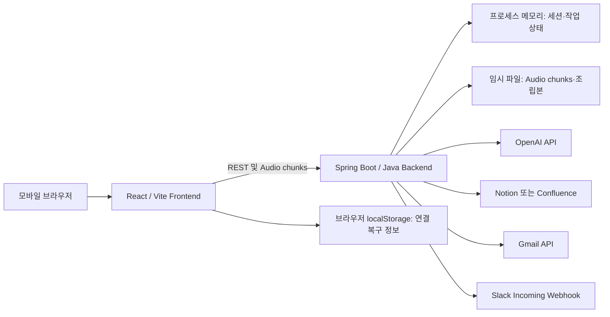

# Meeting Automation 아키텍처

> 이 문서는 현재 소스의 런타임 구성을 설명합니다. 제품 요구사항과 구현 간 차이 및 저장 위치는 [현재 구현 기준](./implementation-status.md)을 참고하세요.

## 시스템 경계

| 구성 | 기술 / 역할 |
|---|---|
| Frontend | React 19, TypeScript, Vite 7, React Router. 모바일 회의 UI와 브라우저 녹음 및 API 호출 |
| Backend | Java 25, Spring Boot 4.1. REST API, 세션, 오디오 조립, AI·문서·알림 Adapter |
| 음성 처리 | OpenAI Audio Transcriptions API, 기본 `gpt-4o-transcribe-diarize` |
| 회의록 생성 | OpenAI Chat Completions API Structured Outputs, 기본 `gpt-6-luna` |
| 문서 Provider | Notion API, Confluence Cloud REST API v2 |
| 이메일·알림 | Gmail API OAuth 2.0, Slack Incoming Webhook |
| 배포 대상 | 정적 Frontend는 Vercel, Java Backend는 Render |

Vercel은 오디오를 저장하거나 중계하지 않습니다. 브라우저가 오디오를 Backend API에 직접 업로드합니다. SQL 데이터베이스, Redis, 외부 메시지 큐는 없습니다.

## Backend 책임

Backend에는 다음 API 및 서비스 영역이 있습니다.

- 앱 설정, 문서 연결 초기화·변경 및 연동 상태 조회
- 참석자와 회의록 템플릿 조회·관리
- 회의 세션 생성, 녹음 조각 수신·검증, 업로드 상태 확인
- 오디오 조립, OpenAI 전사·화자 구간 정규화, 구조화 회의록 초안 생성
- 회의록 및 화자 매핑 저장·검증, 문서 본문 생성 및 저장
- Gmail 이메일, Slack 알림 발송과 결과·재시도 관리
- 문서 연결 장애·작업 상태 및 안전한 오류 정보 제공

주요 코드는 `backend/src/main/java/com/meetingautomation/` 아래에서 API, application service, provider adapter로 나뉩니다. 외부 API 모델은 Adapter 내부에서 서비스 DTO로 변환됩니다.

## 회의 흐름

1. Frontend가 앱 설정과 문서 Provider의 템플릿·참석자 목록을 조회합니다.
2. 회의 정보를 전송해 Backend 메모리에 회의 세션을 생성합니다.
3. 브라우저에서 마이크 입력을 확인하고 `MediaRecorder`로 오디오 조각을 생성합니다. 전송 대기 조각은 브라우저 저장소에 잠시 보관하고 Backend의 Audio API로 보냅니다.
4. Backend는 조각의 순서, 크기, MIME type, checksum을 확인한 뒤 임시 파일에 저장합니다.
5. 녹음 종료 후 Backend는 오디오를 조립하고 OpenAI 전사·화자 구간 분석을 실행합니다.
6. 전사 결과와 기본 템플릿으로 구조화 회의록 초안을 생성하고 세션을 검토 상태로 바꿉니다.
7. 사용자는 검토 화면에서 화자 매핑과 회의록 내용을 저장하고 검토를 완료합니다.
8. Backend는 선택 템플릿과 검토 완료 회의록을 문서 작성 모델에 전달해 Markdown 페이지를 만듭니다. 문서 Provider 저장 성공 후 활성화된 이메일과 Slack 알림을 처리합니다.
9. Frontend는 문서 저장, 이메일, Slack 결과를 단계별로 보여줍니다. 저장된 회의는 이후 목록과 상세 화면에서 문서 Provider로부터 조회합니다.

## 저장 및 재시작 동작

| 데이터 | 저장 방식 | 재시작 동작 |
|---|---|---|
| 문서·Slack·이메일 설정 | 로컬은 조건부 AES-GCM 파일 또는 메모리. Render는 메모리 저장소 | 브라우저가 localStorage 복구 정보를 보내 설정을 다시 등록할 수 있음 |
| 브라우저 복구 정보 | Origin 범위 `localStorage` | 동일 브라우저 프로필에서만 사용할 수 있음 |
| 회의 세션·처리·전달 상태 | Backend 프로세스 메모리 | 복구 보장 없음 |
| Audio chunk·조립 파일 | `TEMP_AUDIO_DIR` 임시 파일 | 영구 저장·재시작 복구 보장 없음 |
| 완료 문서와 참석자·템플릿 | Notion 또는 Confluence | Provider 정책에 따라 보존 |

Render의 런타임 설정 저장소는 프로세스 메모리에 있으므로 브라우저 복구가 실행되기 전 설정 API가 비어 있을 수 있습니다. Render 운영 상태, 플랫폼 파일 보존, 실제 Provider 접근은 이 아키텍처 문서만으로 검증되지 않습니다.

오디오 업로드 대기 조각은 브라우저 저장소에서 Backend ACK 전까지 보유합니다. Backend는 실패 처리 재시도용 오디오를 제한된 기간 임시 보존하고, 회의록 초안 생성 성공 후 삭제합니다. 구체적인 만료 동작은 [현재 구현 기준](./implementation-status.md)과 코드의 Audio cleanup을 따릅니다.

## 보안과 진단

- OpenAI 키는 Backend 설정에 둡니다. 문서, 이메일, Slack 연결 입력은 브라우저 `localStorage`에 복구용으로 남고 Backend 설정 저장소에도 전달됩니다.
- Backend는 저장된 연결 값을 API 응답에 원문으로 돌려주지 않고, 로그에서는 Secret과 회의 내용을 제외합니다.
- 브라우저 localStorage는 암호화된 자격 증명 저장소가 아닙니다. 브라우저 프로필과 기기를 보호해야 합니다.
- CORS 허용 Origin은 `ALLOWED_ORIGINS`에서 관리합니다. CORS는 인증 수단이 아닙니다.
- `traceId`, 세션 ID, 단계와 안전한 오류 코드로 실패 위치를 확인합니다. Health API 응답 하나만으로 AI·문서·메일 등 전체 흐름의 성공을 판단하지 않습니다.

## 관련 문서

- [현재 구현 기준](./implementation-status.md)
- [제품 요구사항](./PRD.md)
- [REST API 명세](./api-spec.md)
- [데이터 명세](./data-spec.md)
- [외부 서비스 연동](./integrations.md)
- [문서 연결 설계](./document-setup.md)
